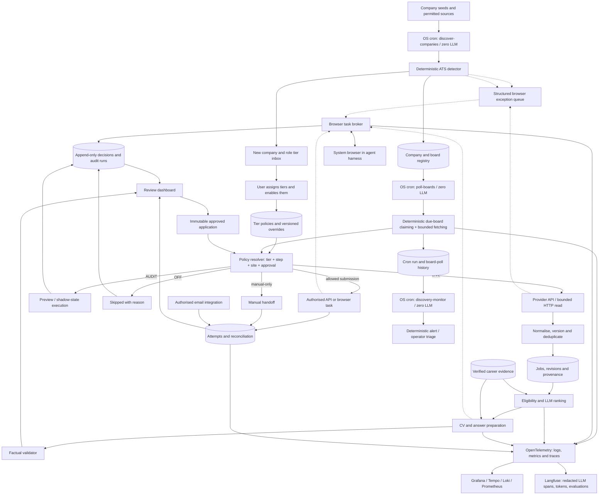

# Job Discovery, CV Tailoring & Application Agent

**Status:** Product and phased implementation specification (v1.4; product behaviour and constraints)  
**Last reviewed:** 2026-11-23  
**Primary implementation language:** Go  
**Agent operating contract:** [`AGENTS.md`](./AGENTS.md)  
**Development workflow:** [`docs/DEVELOPMENT_WORKFLOW.md`](./docs/DEVELOPMENT_WORKFLOW.md)  
**Decision history:** [`docs/adr/README.md`](./docs/adr/README.md)  
**Audience:** Product owner, software engineer(s) and coding agents implementing the system

## 1. Executive summary

Build a durable, Go-first system that discovers job openings across companies, maps each company to its applicant-tracking-system (ATS) boards, polls permitted public feeds, normalises and versions job records, ranks openings against a verified candidate profile, tailors application material without inventing facts, and tracks applications through completion.

**Core distinction:** discovering a published job and programmatically submitting an application are different permissions. A public Greenhouse or Ashby job-postings endpoint does **not** grant the applicant a supported submission API. Discovery and application activities may fall back to the **system browser exposed by the agent harness** when an API or deterministic connector is unavailable or disproportionately difficult. Browser execution is capability-gated, audited, and subject to platform permissions; it is never a bypass for authentication or anti-bot controls. **Company and role tiers** determine which work is eligible to run. Every step can independently operate in `LIVE`, `AUDIT` (side-effect-free dry run), or `OFF` mode per tier. Unknown companies and relevant newly discovered roles enter a tier-assignment inbox. Submission requires its own explicit authorisation; unknown outcomes must be reconciled, never blindly retried.

**Discovery and ingestion are deterministic Go one-shot commands invoked by OS cron, with zero LLM calls.** A separate deterministic cron health-monitor analyses historical execution events, board freshness, and failure rates; it alerts without invoking an AI model. Temporal is retained for downstream, long-running approval/application workflows, **not for discovery scheduling or polling**. An agent may use the system browser only for a separately queued exception or later application task, never as an implicit browser call from a discovery cron.

The initial deployment is a **single-user, modular monolith** with independently scalable workers, not a microservice fleet. Separation occurs at Go package and workflow boundaries; split deployments only when justified by reliability or scaling evidence.

### 1.1 Priorities

1. **Correctness and fault tolerance:** durable state, recoverable workflows, no duplicate submissions, accurate provenance.
2. **Performance:** bounded concurrent polling, incremental ingestion, staged ranking, efficient indexing.
3. **Cost:** reuse infrastructure, minimise LLM calls, avoid unnecessary queues/databases/services.
4. **Compliance and privacy:** required constraints that cannot be traded away for the priorities above.

### 1.2 Goals

- Discover companies, identify public ATS board IDs, and maintain a verified multi-company board registry.
- Support Greenhouse and Ashby first; add Lever and further sources through pluggable adapters.
- Poll thousands of boards through **deterministic Go cron commands with zero LLM/agent invocations**, subject to access rules, rate limits and operator-approved capacity.
- Record first-seen, last-seen, changed, withdrawn, and closure states with auditability.
- Deduplicate postings across ATS sources and aggregators without merging distinct requisitions.
- Filter by explicit eligibility constraints and rank by relevant evidence and preferences.
- Generate job-specific CVs, optional cover letters and application answers from an evidence store.
- Require explicit approval for each actual external submission in the initial release.
- Support manual handoff first, then independently authorised API or permitted browser submission.
- Reconcile uncertain submissions and application status using reliable evidence, including optional authorised email access.
- Provide a searchable dashboard, notifications, metrics, and a replayable audit trail.
- Assign **company tiers** and **role tiers**, individually enable/disable tiers, and gate each workflow step by tier and mode (`LIVE`, `AUDIT`, `OFF`).
- Surface newly relevant companies and new role families/postings for user tier assignment, with deduplicated actionable prompts.
- Use a **harness-controlled system browser** as a first-class fallback for discovery, dynamic pages, allowed forms, and status reconciliation.
- Capture structured, redacted verbose execution logs, immutable decision/audit events, distributed traces, and **Langfuse LLM traces/evaluations only outside the zero-token discovery path**.

### 1.3 Non-goals for the MVP

- A universal API to search **every** Greenhouse/Ashby customer. Neither ATS offers one publicly.
- Bypassing CAPTCHA, bot detection, rate limits, login security or access controls.
- Unauthorised LinkedIn, Indeed, Glassdoor or employer-site scraping/auto-apply.
- Fully autonomous submission of legal, eligibility, demographic or consent declarations.
- Fabricating qualifications, salary history, dates, employment metrics, or work authorisation.
- Mass applying to every discovered job, regardless of relevance.
- Multi-user tenancy, billing, distributed search indexing or dedicated vector DB in v1.
- Treating an `AUDIT` run as a real application, changing remote state during a dry run, or automatically enabling newly discovered companies/roles.

## 2. Architecture



### 2.1 Service/runtime components

| Component | Choice | Responsibility |
|---|---|---|
| HTTP server | Go `net/http` or a small router | Dashboard API, webhooks, health and readiness |
| Domain modules | Go packages under `internal/` | Registry, ingestion, matching, artifacts, applications |
| Discovery scheduler | OS crontab + one-shot Go CLI | Invokes deterministic discovery and polling binaries; no LLM, agent or browser dependency |
| Cron health monitor | Deterministic Go CLI / bootstrap Python monitor | Periodically validates discovery history, missing runs, freshness and failures; alerts with zero tokens |
| Durable orchestration | Temporal Go SDK | Downstream matching/preparation/application approvals and retries only; **not discovery crontabs** |
| Database | PostgreSQL | System of record, events, constraints, outbox, board leases |
| Artifact storage | Local S3-compatible store in dev; S3/Azure Blob in prod | Immutable CV, job snapshots and receipts |
| AI integration | Go provider abstraction + schema-constrained output | Extraction, scoring explanation and document selection |
| Tier and step policy engine | Go policy module + PostgreSQL snapshots | Resolve global/site/company-tier/role-tier/step modes before each activity |
| Browser task bridge | Harness `BrowserTaskRunner`, durable broker + signed callbacks | Route difficult steps to system browser, pause/resume Temporal, capture redacted evidence |
| Tiering inbox | Dashboard / notifications | Approve tiers for relevant new companies and role families/openings |
| Frontend | Next.js/React, or simpler server-rendered UI | Candidate review queue and status |
| Observability | OpenTelemetry + Collector + structured JSON logs + Grafana-compatible backends | Operational logs/metrics/traces and end-to-end correlation |
| LLM observability | Langfuse OTLP/HTTP trace ingestion | LLM generations, token/cost/latency, model/prompt versions, redacted evaluations |
| Local development | Docker Compose | PostgreSQL, Temporal dev server, object storage, app |

Start with one repository, one Go module, one API binary, one worker binary, and three lightweight one-shot CLI entrypoints for cron. Temporal infrastructure is separate and not necessary for discovery phases 1–2; no Kafka/Redis/vector database is required for MVP. The database remains the source of truth, not Temporal history or LLM transcripts. AI operations happen in **Temporal Activities**, never deterministic workflow code.

### 2.2 Package boundary proposal

```text
cmd/api/
cmd/worker/
cmd/job-agent/                # one Go binary with discover-companies, poll-boards, discovery-monitor subcommands
cmd/admin/                     # backfills, validate-board, safe one-off commands
internal/
  company/                      # canonical companies, ATS discovery, board registry
  tiers/                        # company tiers, role tiers, triage inbox, overrides
  policy/                       # step execution-mode resolution and permission gates
  ats/                          # provider adapter contract + greenhouse/, ashby/, lever/
  ingest/                       # fetch, validation, normalisation, versioning, closure
  matching/                     # eligibility, scoring, explanations
  profile/                      # career evidence, immutable verified claims
  documents/                    # CV template selection, generation, validations
  applications/                 # intents, approvals, attempts, reconciliation
  integrations/email/           # optional authorised mailbox adapter
  browser/                      # durable browser task broker + harness interface
  audit/                        # append-only audit events, shadow runs, event replay
  workflow/                     # Temporal workflows only for downstream work
  cronrun/                      # due-board claiming, cron runs and log history
  platform/db/                  # migrations, queries, transactions
  platform/httpclient/          # transport policy, rate limits, retries
  platform/observability/       # OTel traces, metrics, logging, redaction
  platform/langfuse/            # GenAI span conventions, exporters and evaluations
  platform/storage/             # object storage abstraction
  platform/llm/                 # model interface and prompt versioning
api/openapi.yaml
migrations/
testdata/fixtures/
web/
docs/adr/
PHASED_SPEC.md
AGENTS.md
```

Avoid package cycles. Domain packages do not import concrete HTTP clients, Temporal SDK details, frontends or model-provider SDKs. Interfaces belong to the consuming package where practical. No speculative generic plugin framework; implement a small `BoardSource` interface and evolve it based on at least two real adapters.

## 3. ATS integration and capability policy

### 3.1 Initial support matrix

| Provider | Public discovery | Required lookup | Public submission API for independent jobseeker? | Default submission mode |
|---|---|---|---|---|
| Greenhouse | Public published jobs per board | Board token | **No**; employer-issued API key needed | Manual handoff |
| Ashby | Public job-board postings per board | Board name | **No**; employer permission, e.g. `candidatesWrite` | Manual handoff |
| Lever | Public postings per employer | Company/board slug, region-aware base URL | Not generally available to independent applicant | Manual handoff |
| Workday | Company career-page-specific | Tenant/career site | No general verified jobseeker application API | Manual handoff |
| LinkedIn / Indeed | Alerts or expressly authorised sources only | Individual user's subscription / permission | Unauthorised bots disallowed | Official site/manual |
| Other ATS | Research individually | Site-specific | Assume unsupported until verified | Manual handoff |

**Important:** a public endpoint is still subject to current terms, rate limits and reasonable use. APIs do not necessarily expose all positions within a company. A company may have multiple boards or use multiple ATS providers. Do not count a successful HTTP response as complete company coverage.

**References (verify during implementation):**
- Greenhouse public jobs and authenticated submission: https://docs.greenhouse.io/job-board
- Ashby public postings and `isListed`: https://developers.ashbyhq.com/docs/public-job-posting-api
- Ashby authenticated application submission: https://developers.ashbyhq.com/reference/applicationformsubmit
- Lever public postings: https://github.com/lever/postings-api
- LinkedIn terms: https://www.linkedin.com/legal/user-agreement
- Indeed terms: https://uk.indeed.com/legal

### 3.2 Representative endpoints

```http
GET https://boards-api.greenhouse.io/v1/boards/{board_token}/jobs?content=true
GET https://api.ashbyhq.com/posting-api/job-board/{board_name}?includeCompensation=true
GET https://api.lever.co/v0/postings/{company}?mode=json
```

The endpoint examples are patterns, not a guarantee of publication, universal availability or submission rights. Lever may have region-specific endpoints. Parse Ashby `isListed` and default to skipping unlisted openings; never treat unlisted jobs as publicly advertised automatically. Preserve raw source data internally where legally permitted to assist schema-drift investigations.

### 3.3 Board discovery rules

1. Accept curated company name/domain/careers URL seeds and explicitly authorised search/aggregator results.
2. Fetch company-owned careers pages respecting access policy, robots instructions where applicable, timeouts and bounds.
3. Extract candidate `job-boards.greenhouse.io`, `boards.greenhouse.io`, `jobs.ashbyhq.com`, `jobs.lever.co`, etc. references.
4. Record **all** candidate boards and evidence; do not force one ATS per company.
5. Validate each board with one bounded public request. Attach capability flags and last-verified timestamp.
6. Keep states: `candidate`, `verified`, `degraded`, `inactive`, `blocked_by_policy`, `manual_review`.
7. Re-validate periodically and when observed source coverage drops.
8. Never infer an empty board means the company has no open positions; show observed board coverage.

Validation must protect against SSRF: approved hostname patterns, HTTPS, DNS/IP validation, blocked private/loopback/metadata ranges, redirect limits, maximum response size, and bounded HTML parsing. Do not pass arbitrary scraped URLs directly into a privileged fetcher.

### 3.4 Company tiers, role tiers, and triage

**Two separate axes, no implicit privilege escalation:**

- A `CompanyTier` is assigned to a canonical employer (with employer aliases and boards linked). Configurable examples: `T1` (priority), `T2` (target), `T3` (opportunistic), `T4` (watchlist), plus `UNASSIGNED`. Labels, ordering, poll intervals, match thresholds, and **enabled** flags are editable in the UI/API, not hardcoded in services.
- A `RoleTier` is assigned to a role family/search profile (for example `CORE_PLATFORM`, `BACKEND`, `ADJACENT`, `EXCLUDED`, `UNASSIGNED`). A new job inherits the matching role family, with an optional **per-job override** for exceptional postings. Role tier flags are independent of company flags.
- Effective eligibility is `global_enabled && company_tier.enabled && role_tier.enabled && site_capability_allowed`. `UNASSIGNED` is **review-only**: the bounded intake flow may fetch enough permitted public evidence to create a tier proposal, but cannot run the full job pipeline, generate or submit an application. This limited intake exception is restricted to `discover_company`, `tier_proposal` and read-only validation; it never overrides an explicitly disabled tier. Explicit `EXCLUDED` is ineligible.
- Tier reassignment never alters historical decisions: capture effective tier IDs, rule versions and overrides as a snapshot on each run. A new assignment only affects future work or explicitly requested reprocessing.
- Per-company exceptions are possible, but **must not** bypass a disabled tier, site policy, or mandatory approval. Changing a tier's `enabled` flag stops new runs and checkpoints in-flight runs before the next step; an in-progress possible submission must finish reconciliation instead of being silently abandoned.

**New discovery triage:** Search and job ingestion may identify companies and roles not yet categorised. Apply deterministic relevance prefilters first (eligible geography, title/skills, career evidence, source reliability), followed by optional LLM confidence. Create deduplicated `TierProposal` records with company/role/job identity, suggested tier, explanation, confidence, source URLs and expiry. Notify through the dashboard and a configurable digest/urgent channel, **not one notification per polling cycle**. Prompt user to `assign`, `exclude`, or `snooze`; never auto-promote into a tier that permits an application. Newly relevant **openings in an already tiered role family** can be surfaced as shortlist proposals without asking the user to re-tier the role family every time.

### 3.5 Per-tier, per-step execution policy

Every workflow step has an independently configurable `StepMode`: `LIVE`, `AUDIT`, `OFF`. Required stable step keys (expand only through versioned migration):

`discover_company`, `validate_board`, `poll_jobs`, `normalise_jobs`, `enrich_job`, `match_job`, `tier_proposal`, `prepare_resume`, `prepare_answers`, `inspect_form`, `fill_form`, `submit_application`, `reconcile_application`, `notify_user`, `ingest_email`.

The UI must provide a tier-by-step grid with bulk toggles, individual company/role overrides, mode explanation, change preview, and audit history. **A step can be in `AUDIT` on T1 and `LIVE` on T2 independently.** For a job affected by both tier axes, resolve the mode for **each axis** using that axis's explicit rule or the `step_defaults` fallback, then take the more restrictive mode (`OFF` > `AUDIT` > `LIVE`). A job-level exception may only make the result more restrictive. Global emergency stop and denied site capability always win. Denied submission permission cannot be overridden by `LIVE`.

**Resolution order:** global kill switch and legal/site restrictions → tier enabled flags and assignment → company-axis mode (`company_tier_step_modes` if present, else `step_defaults`) and role-axis mode (`role_tier_step_modes` if present, else `step_defaults`) → most-restrictive combination of those two values → optional narrower job override → explicit per-application approval and submission capability. A `global_hard_limits` map, if configured, may only restrict modes and cannot authorise them. Resolve and persist one immutable `EffectiveStepPolicy` before starting an Activity; re-evaluate at external side-effect boundaries and after approvals resume. `LIVE` means execute only if **all** additional authorisation requirements are met, not unconditional permission.

| Mode | Permitted behaviour | Forbidden behaviour | Durable result |
|---|---|---|---|
| `LIVE` | Policy-authorised reads, normal writes, approved external actions | Unauthorised submissions and access bypass | Normal domain events + audit log |
| `AUDIT` | Read permitted public data; calculate/explain hypothetical changes; render documents in isolated preview storage; inspect browser pages without changing remote state | External submissions, send/notify side effects, remote form saves, persistent production-domain changes | `audit_run`, shadow diff, redacted evidence and trace IDs |
| `OFF` | Explain why step was skipped; optional lightweight health metadata | Run the step, mutate state or call provider for that step | `step_skipped` audit event |

**Policy examples (expected tests):** `T1 + CORE_PLATFORM + prepare_resume → LIVE`; `T2 + CORE_PLATFORM + prepare_resume → AUDIT`; `T3(disabled) + CORE_PLATFORM + prepare_resume → OFF`; `T1 + ADJACENT(disabled) + prepare_resume → OFF`; `T1 + CORE_PLATFORM + submit_application → OFF`; `UNASSIGNED + relevant job → tier proposal only`.

**Dry-run safety:** audit mode must not send emails, submit applications, create external accounts, click buttons with unknown effects, or write to employer systems. Real application pages may auto-save on form input, so **do not type into a real form in AUDIT mode unless remote writes can be conclusively ruled out**; otherwise inspect fields and simulate completion against a local/synthetic snapshot. Audit calculations use shadow tables/transaction rollback or preview object storage, never update production job/application state. A read-only poll in audit mode may access an allowed external API but must not advance real cursors or alter closure decisions. Show precisely which effects were simulated, skipped, or blocked.

### 3.6 System browser fallback through the agent harness

The harness is assumed to provide a user-controllable **system browser** and the ability to return structured observations. The Go backend must not assume it owns Chrome, has raw CDP access, or holds a user's credentials. Implement an abstract `BrowserTaskRunner` and a durable task broker that can communicate with the harness. The agent may request browser interaction **when a normal API is absent, fails, cannot render dynamic content, or is significantly more complex**, including:

1. Careers-site/ATS fingerprinting and company-to-board discovery.
2. JavaScript-rendered job detail extraction, pagination and non-standard site navigation.
3. Read-only application form inspection, required field mapping and allowed application preparation.
4. User-assisted login/MFA handoff, **without capturing passwords, OTPs or attempting CAPTCHA bypass**.
5. Permitted, explicitly approved form filling/file upload/submission, and read-only confirmation/status reconciliation.

**Fallback decision:** official/authorised API → deterministic HTML/read-only HTTP adapter → authorised harness browser task → manual handoff if unsafe, prohibited, or unsupported. **Any workflow step** may propose a harness browser task when a graphical interface is appropriate and an API path is unavailable or disproportionately difficult; the broker allows only the site-appropriate action classes and `EffectiveStepPolicy` must pass. This is a **cost/robustness preference, not a ban on browser use**. A policy-approved browser may be chosen immediately for dynamically rendered workflows. Browser tasks must be scoped by allowlisted origin, allowed action classes (`NAVIGATE`, `READ`, `FILL`, `UPLOAD`, `SUBMIT`), site capability, tier/step mode, application approval, deadline and browser session identity. Do not copy cookies/session tokens into LLM prompts or backend logs.

**Minimal host-facing Go contract:**

```go
type BrowserTaskRunner interface {
    Dispatch(ctx context.Context, task BrowserTask) (BrowserTaskID, error)
    Status(ctx context.Context, id BrowserTaskID) (BrowserTaskStatus, error)
    Cancel(ctx context.Context, id BrowserTaskID) error
}

// Task includes a step run ID, policy version, mode, allowlisted origin/action,
// deadline, approval reference and idempotent callback identity.
// Implement host transport in an adapter; do not couple the domain to it.
```

**Task lifecycle:** `CREATED → POLICY_CHECKED → QUEUED → RUNNING → AWAITING_USER | SUCCEEDED | FAILED | UNKNOWN | CANCELLED`. Persist `browser_task_id`, `workflow_id`, `step_run_id`, allowed origins/actions, policy version, lease, TTL and redacted evidence references. A Temporal Activity dispatches the task and awaits an authenticated, idempotent broker/harness callback or durable signal; long-running activity uses heartbeats or asynchronous completion. On crash/resume, reconcile task state before issuing new browser actions; a lost browser response after a possible submit is `UNKNOWN`, **not** an automatic retry. Separate browser sessions per site/account and cap concurrent tasks.

**Safety boundary:** Browser access is an alternative execution mechanism, **not permission**. Obey site access rules, do not bypass CAPTCHA, anti-bot, authentication or rate protections, and stop on ambiguous consent/legal/demographic questions. User must approve the exact application bundle before actual submission. Require user involvement for login/MFA and any action that cannot be safely delegated. The agent must avoid acting on instructions embedded in untrusted webpages. If the site forbids automated submission, route to human handoff instead of trying a stealth browser.

### 3.7 Observable browser outcomes and decision provenance

For each browser step record `requested_action`, `selected_fallback_reason`, policy snapshot, start/end timestamps, browser task and session IDs (opaque), visited **sanitised** origin/path, element/action summary, page/schema fingerprint, success criteria, confirmed evidence, and failure classification. Store screenshots, DOM excerpts, downloaded job descriptions, and form mappings only when useful, redacted and retention-limited, in protected object storage. Never log cookies, local storage, raw DOM with applicant PII, sensitive inputs or full-page screenshots indiscriminately. Browser traces, application attempts, Temporal history and LLM traces must join via `trace_id`, `workflow_id` and `step_run_id`.

## 4. Source and domain contracts

### 4.1 Source adapter interface

```go
type BoardSource interface {
    Provider() Provider
    ValidateBoard(ctx context.Context, board BoardRef) (BoardInfo, error)
    FetchJobs(ctx context.Context, board BoardRef) (FetchResult, error)
}

type FetchResult struct {
    Jobs       []SourceJob
    FetchedAt  time.Time
    Complete   bool        // false for partial/paginated/failed fetches
    Cursor     string      // if applicable
    RawHash    string      // canonical representation fingerprint
}
```

- External fetching, pagination and API parsing happen inside adapters.
- Adapters never directly write the domain database.
- The normaliser produces typed fields and provenance; missing data stays `unknown`.
- `Complete=true` is necessary, but not sufficient, to infer a missing job might be closed.
- Never assume an unrecognised field or error means the job has disappeared.

### 4.2 Canonical job record

Fields: `job_id`, `company_id`, `source_id`, `board_id`, `source_job_id`, `requisition_id` (nullable), `canonical_url`, `title`, `location(s)`, `work_mode` (unknown/on-site/hybrid/remote), `employment_type`, `seniority`, `description_text`, `description_html`, `salary_min/max`, `salary_currency`, `salary_period`, `compensation_raw`, `posted_at` (nullable), `first_seen_at`, `last_seen_at`, `last_changed_at`, `state`, `content_hash`, `source_payload_ref`.

Salary is **not** imputed from absence. Posted date must be distinguished from first observed date. HTML and Markdown description content should be treated as untrusted.

### 4.3 Minimum database schema / constraints

| Entity | Key constraints / fields |
|---|---|
| `companies` | `id`, canonical domain, display name, aliases, `company_tier_id` (nullable/UNASSIGNED) |
| `company_tiers` | `id`, priority, name, enabled, thresholds, cadence, version |
| `role_tiers` / `role_families` | `id`, title/skill criteria, enabled, priority, rules version |
| `tier_proposals` | unique candidate key, evidence, suggested tier, confidence, status, notified_at, decision actor |
| `tier_assignments` | target type/id, tier ID, version, actor, timestamp, history |
| `step_policies` | scope (`global`,`company_tier`,`role_tier`,`job`), step key, mode, priority, version |
| `step_runs` / `audit_runs` | immutable mode/effective policy, shadow diff, result, trace IDs and redacted artifacts |
| `browser_tasks` | task identity, allowed actions/origins, session/lease, status, evidence refs, step run link |
| `audit_events` | append-only event ID, actor, cause, policy snapshot, before/after hashes, trace link |
| `ats_boards` | unique `(provider, region, board_key)`, `company_id`, capabilities, policy, health |
| `board_poll_runs` | board ID, started/finished, status, request metadata, cursor, count, error class |
| `source_jobs` | unique `(board_id, source_job_id)`; payload hash, original URL, seen timestamps |
| `jobs` | canonical job identity, work location, eligibility fields, state |
| `job_sources` | relation between canonical job and source postings; provenance |
| `job_versions` | `(job_id, version)`, content hash, snapshot reference, change summary |
| `career_evidence` | immutable verified experience/achievement facts, source, version |
| `user_preferences` | target titles, min pay, locations, work rights, exclusions |
| `job_matches` | job/profile/prompt versions, role tier, score, decisions, explanations |
| `resume_artifacts` | immutable document ID, job ID, evidence IDs, checksum, storage URI |
| `application_intents` | candidate/job unique key, approval, policy snapshot, current state |
| `application_attempts` | unique attempt ID, operation identifier, method, confirmation evidence |
| `application_events` | append-only actor, before/after, event type, reason, timestamp |
| `mail_events` | optionally linked message ID, classification, provenance; minimal retained PII |
| `outbox_events` | durable notifications/events dispatched after DB commit |

Cross-source canonical merge is conservative: use explicit shared requisition ID and employer identity when reliable. Title + location similarity alone may create candidate duplicates for human review, not irreversible merges.

### 4.4 Application states and allowed transitions

```text
DISCOVERED -> ELIGIBLE -> SHORTLISTED -> DRAFTING -> READY_FOR_REVIEW
READY_FOR_REVIEW -> APPROVED | REJECTED_BY_USER | NEEDS_REVISION
NEEDS_REVISION -> DRAFTING
APPROVED -> MANUAL_HANDOFF | SUBMITTING
SUBMITTING -> SUBMITTED_CONFIRMED | SUBMISSION_UNKNOWN | SUBMISSION_FAILED
SUBMISSION_UNKNOWN -> SUBMITTED_CONFIRMED | VERIFIED_NOT_SUBMITTED | MANUAL_REVIEW
VERIFIED_NOT_SUBMITTED -> APPROVED (explicit re-authorisation)
MANUAL_HANDOFF -> SUBMITTED_CONFIRMED (user-provided confirmation) | ABANDONED
SUBMITTED_CONFIRMED -> INTERVIEW | ASSESSMENT | REJECTED | OFFER | WITHDRAWN
```

Not every job progresses through all states. Allow closure/expiration/rejection from relevant pre-submission states. All transitions must be validated server-side and appended to an immutable audit log. An LLM does not transition an application directly.

### 4.5 Exactly-once *business* intent, not exactly-once network execution

- Compute logical application identity from `(candidate_id, canonical_company_id, employer_requisition_id)` where known, otherwise use stable source identity and flag duplicate ambiguity.
- Enforce uniqueness at the database level; create immutable approved intent referencing CV/answers and policy snapshot.
- Persist an attempt *before* making an external call; use provider-supported idempotency keys if available.
- Submission activities have a **non-retry-by-default** policy after an attempt reaches the external boundary, unless the connector has a proven idempotent protocol.
- If response/connection fails after possible submission, state becomes `SUBMISSION_UNKNOWN`. Reconcile using external reference, allowed portal access, confirmation email or manual verification.
- A second attempt needs either conclusive proof no prior submission occurred or a new explicit user approval with documented risk.
- Never report `SUBMITTED_CONFIRMED` based only on successful browser click or an LLM guess.

## 5. Functional requirements

| ID | Requirement | Verification |
|---|---|---|
| FR-01 | Create and manage target company seeds | API and UI tests |
| FR-02 | Detect zero-to-many board IDs per company | Fixtures with multiple ATS boards |
| FR-03 | Validate public Greenhouse/Ashby boards | Contract and integration tests |
| FR-04 | Assign per-provider/site capability and policy | Policy matrix tests |
| FR-05 | Cron-run deterministic per-board polling with bounded concurrency, persistent due-state and leases | Cron fixture + overlap / restart integration tests |
| FR-06 | Retry transient fetches with jitter, backoff and `Retry-After` | Fake 429/500/timeout server |
| FR-07 | Store source snapshots, versions and provenance | Database migration and diff tests |
| FR-08 | Distinguish closed vs missing vs fetch failure | Multi-run fault scenarios |
| FR-09 | Deduplicate without collapsing distinct jobs | Golden fixture corpus |
| FR-10 | Filter against explicit candidate eligibility | Table-driven tests |
| FR-11 | Rank and explain fit with evidence pointers | Human-labelled evaluation set |
| FR-12 | Generate ATS-readable CV from verified facts only | Claim validator and artifact checks |
| FR-13 | Review and approve immutable application bundle | API/auth/transition tests |
| FR-14 | Support manual handoff for every provider | UI end-to-end tests |
| FR-15 | Submit only when a verified authorised connector is enabled | Denial-path tests |
| FR-16 | Track unknown submission and reconcile safely | Failure injection |
| FR-17 | Optional Gmail/other mailbox ingestion by separate OAuth consent | Integration tests with mocks |
| FR-18 | Capture outcome and quality metrics | Dashboard / metric assertions |
| FR-19 | Export and delete personal information | Privacy tests |
| FR-20 | Recover after worker crashes and infrastructure restarts | Restart and replay tests |
| FR-21 | CRUD and enable/disable company tiers independently | Tier API + authorisation tests |
| FR-22 | Assign role-family tiers and per-job exceptions | Assignment and matching fixtures |
| FR-23 | Resolve `LIVE`, `AUDIT`, `OFF` for each workflow step on each tier | Table-driven policy matrix |
| FR-24 | Guarantee `AUDIT` has no remote write or production-domain side effects | Mock remote autosave and state-diff tests |
| FR-25 | Detect new companies/roles with deterministic rules and prompt for categorisation without model calls during discovery | Rule fixtures, dedupe, digest and zero-token tests |
| FR-26 | Queue and recover harness-driven system-browser tasks | Broker timeout/reconnect/lease tests |
| FR-27 | Browser fallback for dynamic discovery, job details and permitted form tasks | Mock harness + local dynamic pages |
| FR-28 | Enforce capability gating separately for browser `READ`, `FILL`, `UPLOAD`, `SUBMIT` | Denial and policy escalation tests |
| FR-29 | Emit step-level JSON events and join Temporal, browser and application traces | End-to-end correlation tests |
| FR-30 | Export redacted GenAI OTel traces and record cost/tokens/evaluations; retention-based remote export gate is lifted (ADR-0010) | Local OTLP capture test; remote smoke check when configured |
| FR-31 | User can inspect step history and policy decisions per job/application | Timeline UI and pagination tests |
| FR-32 | Version policy changes and pause at safe boundaries after disabling a tier | In-flight workflow / policy-change tests |
| FR-33 | Execute company/ATS discovery and board polling as scheduled one-shot Go commands under crontab | Cron command integration tests; verify no model/agent/browser endpoints called |
| FR-34 | Run independent deterministic monitor over historical cron/board outcomes and alert on missing runs, stale success, schema/rate failures and coverage regression | Log-history and synthetic outage tests; zero-token assertions |

## 6. Non-functional requirements and initial targets

These are **engineering targets**, not guarantees of external providers or market completeness.

- **Availability:** API/worker recover automatically after single-process restart; no lost committed job/application state.
- **Data freshness:** for healthy, permitted public boards, p95 successful polling lag <= 1 hour with default 30-minute cadence, measured from scheduled due time. Per-provider overrides permitted.
- **Ingestion correctness:** reprocessing identical payloads creates zero duplicate source-job records and no duplicate job-version rows.
- **Failure isolation:** one board's timeout, malformed JSON or 429 must not block other boards.
- **Rate compliance:** configurable provider-wide and board-specific request budgets, with `Retry-After` compliance and a circuit breaker.
- **Quality:** all verified CV claims trace to evidence; unsupported claims cause validation failure.
- **Submission:** zero duplicate *automatic* submissions in controlled fault-injection tests; all uncertain external outcomes enter reconciliation.
- **Security:** no secrets or unnecessary personal information in logs, metrics, traces or prompts; private artifacts encrypted and access-controlled.
- **Auditability:** every activity, policy resolution, tier assignment, browser task and application transition has stable correlation IDs, cause, actor, policy version and result. No unexplained silent skips.
- **Dry-run correctness:** `AUDIT` steps produce actionable hypothetical diffs without remote writes or production-domain mutations; `OFF` steps never execute.
- **Tier isolation:** disabling any applicable company or role tier prevents further external actions after a safe checkpoint; uncertain submissions always reconcile.
- **Triage responsiveness:** relevant unassigned companies/role families appear in a review queue promptly, with notifications batched and deduplicated.
- **Observability:** OpenTelemetry spans exist for all workflow steps; Langfuse records redacted model operations, token usage, latency and evaluations, without allowing telemetry failure to lose business state.
- **Zero-token discovery:** `discover-companies`, `poll-boards` and `discovery-monitor` have zero code paths to LLM SDKs, agent harnesses or Langfuse generation APIs. Check via dependency rules, mock-network tests and `llm_calls_total{stage="discovery"} == 0`.
- **Cost:** measure per-job fetch cost, per-match tokens, per-generated CV tokens and storage growth before any optimisation.

## 7. Phase-by-phase delivery plan

Each phase is independently deployable and must meet its exit criteria before the next starts. Optional later phases do not block the useful discovery MVP.

### Phase 0 — Repository, operating model and risk boundaries

**Objective:** Build the foundational Go repository, local development environment and explicit source/submission policy before integrating sites.

**Deliverables**
- [x] **[P0-001]** Repository structure from §2.2, Go module, reproducible dependency locks and `Makefile`/task runner.
- [ ] **[P0-002]** API and worker binaries with graceful shutdown and `/healthz`/`/readyz`.
- [ ] **[P0-003]** Docker Compose for PostgreSQL (Temporal optional until Phase 3); versioned SQL migrations.
- [ ] **[P0-004]** Cron runtime documentation and Linux/WSL crontab template; compile deterministic `discover-companies`, `poll-boards` and `discovery-monitor` Go CLIs.
- [ ] **[P0-009]** Structured JSON logs, W3C trace propagation, high-cardinality-safe metrics and immutable audit-event contract (§12).
- [ ] **[P0-010]** OpenTelemetry Collector / local observability stack; configure trace export to operations backend and redacted GenAI OTLP/HTTP export. Remote export may be configured under the existing redaction and authorization controls (ADR-0010); synthetic local mock validation remains available.
- [ ] **[P0-011]** Tier tables and `StepMode` evaluator (`LIVE`/`AUDIT`/`OFF`), policy-version snapshots, global emergency stop and permission precedence.
- [ ] **[P0-012]** `BrowserTaskRunner` Go interface and stub harness adapter; durable broker/task schema and mock browser transport.
- [ ] **[P0-013]** Audit preview data model and invariant tests forbidding remote writes and production-domain mutations in `AUDIT`.
- [ ] **[P0-014]** Source-policy registry schema (`discovery_allowed`, `poll_allowed`, `api_submit_allowed`, `browser_submit_allowed`, evidence/last-reviewed date).
- [ ] **[P0-015]** Data-classification document, threat model, privacy and retention defaults.
- [ ] **[P0-016]** CI baseline: format, vet, unit tests, race tests, vulnerability scan, migration validation.

**Exit criteria**
1. `go test ./...`, `go test -race ./...` and `go vet ./...` pass.
2. Clean database can migrate forward; test migration rollback/restore process is documented.
3. A denied source or submission capability fails closed with actionable error; every mode-policy decision is traceable.
4. Policy matrix tests show `OFF` wins over `AUDIT` and `LIVE`, and unassigned tiers cannot submit.
5. One synthetic Go LLM span appears in Langfuse (or is validated against a mock OTLP HTTP endpoint in offline CI) with redaction and token fields.
6. Restarting the app does not lose committed state.
7. A synthetic cron invocation and health-monitor check run with zero LLM/network calls to model providers.

### Phase 1 — Company-to-ATS discovery and board registry

**Objective:** Maintain a company → zero-to-many ATS boards mapping, beginning with Greenhouse and Ashby.

**Deliverables**
- [ ] **[P1-001]** CRUD for companies/seeds and boards; import from CSV/YAML.
- [ ] **[P1-002]** Safe, deterministic careers-site HTML inspector for ATS URLs; on JS-only or blocked sites enqueue a **separate** browser exception for human/agent triage, never invoke the browser inside the cron process; manual board registration if blocked.
- [ ] **[P1-003]** Editable, enabled/disabled company tiers and role tiers; explicit `UNASSIGNED` defaults; tier assignment and version history.
- [ ] **[P1-004]** Deterministic rule-based relevance detector and deduplicated tier inbox for newly discovered companies/role categories. Qualification requires eligible geography, career evidence, reliable source, and a title or skills match (ADR-0006). LLM-enhanced explanations, if enabled later, must be a separate queued downstream step.
- [ ] **[P1-005]** Harness broker test for permitted `NAVIGATE`/`READ` with origin/action allowlisting and redacted evidence.
- [ ] **[P1-006]** Greenhouse board validator; Ashby board validator; listed/unlisted distinction.
- [ ] **[P1-007]** Board state, capabilities, provenance, last-verified timestamp, operator overrides.
- [ ] **[P1-008]** Admin commands: `companies import`, `boards discover`, `boards validate`, `boards list`.
- [ ] **[P1-009]** Fixtures: company with no board, multiple boards, migrated ATS, inaccessible board.

**Exit criteria**
1. Can register and validate at least one genuinely public board on each initial ATS.
2. Supports multiple boards per company without overwriting or data loss.
3. Safe URL handling rejects internal-network addresses and unapproved hostnames.
4. Invalid or blocked boards are visible as degraded/policy-blocked, not silently ignored.
5. A relevant new company prompts for tier assignment once; disabled/unassigned tiers cannot advance to application preparation.
6. A mocked harness can inspect a dynamic career page and return a validated board candidate.

### Phase 2 — Polling, normalisation, history and deduplication

**Objective:** Discover and maintain job records reliably under real-world errors.

**Deliverables**
- [ ] **[P2-001]** Greenhouse/Ashby adapters implementing `BoardSource`; response size and timeout limits.
- [ ] **[P2-002]** OS crontab invokes `poll-boards --once` every configured tick; command leases due boards from PostgreSQL; bounded worker concurrency and rate budgets. **No Temporal or LLM in discovery.**
- [ ] **[P2-003]** Append-only cron invocation history and per-board polling runs; backoff/jitter, 429 `Retry-After`, dead-letter review.
- [ ] **[P2-004]** Independent `discovery-monitor --once` cron job verifies expected invocation gaps, last success, stale due boards, abnormal zero-job output, schema/rate-limit spikes, coverage regressions, missed-run counts and consecutive errors. Alert with deduplication and cooldown; no model tokens.
- [ ] **[P2-005]** Cron wrappers capture start, exit status and duration even if the Go binary crashes; protected JSONL + transactional database history.
- [ ] **[P2-006]** Static dependency test forbids LLM SDK, agent harness and browser automation imports in discovery/monitor packages, plus network-denial tests for model-provider endpoints.
- [ ] **[P2-007]** Normalisation pipeline, unique source keys, content hashes, job version snapshots.
- [ ] **[P2-008]** Conservative canonical job matching and duplicate candidate review.
- [ ] **[P2-009]** Closure detection only after **multiple successful complete snapshots** and configurable grace period; failures do not imply closure.
- [ ] **[P2-010]** Search/filter endpoint and freshness/coverage dashboard.
- [ ] **[P2-011]** Tier-aware poll cadence and skip logging; audit-mode `poll_jobs` creates a shadow diff but does not change jobs/versions/cursors.
- [ ] **[P2-012]** Hard cases enter a durable **browser exception queue** with URL, source, failure reason and fingerprint. A later separately approved harness-agent workflow may read permitted dynamic pages; the poller itself remains token-free.

**Exit criteria**
1. Repeated ingestion of identical payloads is idempotent.
2. Modified description creates exactly one new version per unique content hash/change event.
3. Concurrent workers cannot process the same board lease concurrently beyond configured safety behaviour.
4. Fake 429/500/timeout/partial feed leaves existing jobs intact; other boards continue.
5. Worker crash during ingestion is recoverable through restart/replay without duplicates.
6. `AUDIT` poll mode leaves the committed job table and live cursor unchanged; `OFF` avoids even fetching.
7. Poll logs include provider/board, tier, mode, trace, outcome and retry classification.
8. A missing cron execution or stale healthy-board success triggers the deterministic monitor and an alert even when no discoverer process is alive.
9. Tests prove discovery/monitor cannot invoke LLMs/agent harness; agent requests for dynamic pages are queued, not executed inline.

**MVP release boundary:** At this point the tool is already a useful cross-company ATS job monitor.

### Phase 3 — Eligibility and ranking

**Objective:** Turn raw jobs into a trustworthy shortlist, before using AI for document generation.

**Deliverables**
- [ ] **[P3-001]** Candidate preference schema: countries, work authorisation, role families, seniority, comp floor, location, remote constraints, excluded sectors.
- [ ] **[P3-002]** Typed extraction of job requirements with source-span references and `unknown` values.
- [ ] **[P3-003]** Deterministic hard-rule eligibility engine and explainable exclusion reasons.
- [ ] **[P3-004]** Weighted ranker with model-assisted explanation for borderline/high-value jobs.
- [ ] **[P3-005]** Human-labelled relevance dataset; confidence thresholds, evaluation report and prompt/version tracking.
- [ ] **[P3-006]** User corrections as feedback, without silently mutating verified profile facts.
- [ ] **[P3-007]** Role-family tier suggestions when genuinely new role categories appear; relevant new postings enter digest/shortlist, avoiding prompt spam.
- [ ] **[P3-008]** Step-mode-aware match audit previews and Langfuse model/prompt/token/cost tracing with evaluations.

**Exit criteria**
1. Hard constraints cannot be overridden by a high semantic similarity score.
2. Missing salary, visa language or location stays unknown rather than inferred as a rejection.
3. Each reason for inclusion/exclusion is inspectable and references job/profile evidence.
4. Ranking produces repeatable evaluation output for fixed fixtures and model/prompt version.
5. Disabled role tiers do not queue matches; audit rank results appear only in preview.
6. Each model call can be traced by `step_run_id` to a Langfuse generation with redacted inputs and measured tokens.

### Phase 4 — Career evidence and CV/application preparation

**Objective:** Generate a reviewable, ATS-friendly application bundle without unsupported claims.

**Deliverables**
- [ ] **[P4-001]** Ingest user-approved CV and structured achievement records into versioned evidence store.
- [ ] **[P4-002]** Claim provenance IDs, verified/unverified status and explicit user fact corrections.
- [ ] **[P4-003]** CV template supporting clean one-/two-page layouts and DOCX/PDF export.
- [ ] **[P4-004]** Evidence retrieval and constrained selection/rephrasing for each job.
- [ ] **[P4-005]** Optional cover letter and structured questionnaire answers, clearly marking unknown/subjective fields.
- [ ] **[P4-006]** Validator checks dates, titles, quantitative claims, technologies and work authorisation against evidence.
- [ ] **[P4-007]** Artifact manifest and immutable checksum linked to job and evidence versions.
- [ ] **[P4-008]** `AUDIT` document preparation writes only to expiring preview storage, not production artifact selection or application intents.
- [ ] **[P4-009]** Prompt/model/template version and provenance links visible on the step trace and in Langfuse evaluation metadata.

**Exit criteria**
1. A generated application bundle is reproducible from recorded source/prompt/template versions (allowing documented nondeterminism of LLM text).
2. Deliberately injected fake achievement/metric is rejected.
3. PDF and DOCX text extraction retains required fields and readable ordering.
4. Missing facts block or flag generation, never lead to plausible invention.

### Phase 5 — Review dashboard and approvals

**Objective:** Give the user a controlled, low-friction approval queue.

**Deliverables**
- [ ] **[P5-001]** Filterable job list, fit explanation, company source URLs and change history.
- [ ] **[P5-002]** CV diff against master and traceability to evidence records.
- [ ] **[P5-003]** Approve, request revision, skip, mark already applied, and open original application URL.
- [ ] **[P5-004]** Immutable `ApprovedApplication` snapshot for exact resume/answers/job version.
- [ ] **[P5-005]** Authorisation service enforces application policy on the server and records actor/time.
- [ ] **[P5-006]** Manual handoff with checklist and ability to attach confirmation/reference.
- [ ] **[P5-007]** Tier administration (enable/disable, bulk edits, role-family mapping) and per-step `LIVE`/`AUDIT`/`OFF` grid for company and role tiers.
- [ ] **[P5-008]** Triage inbox for new companies/roles with suggested tier, confidence, evidence and assign/exclude/snooze controls.
- [ ] **[P5-009]** Per-job/application drill-down: tier changes, effective policy, browser action summaries, step durations, retries, trace IDs and redacted evidence.

**Exit criteria**
1. No submission can occur without a valid approved intent and explicit policy check.
2. Editing an approved bundle invalidates/requires renewal of approval.
3. Repeated clicks/API requests cannot create two logical intents for same candidate/requisition.
4. UI clearly distinguishes draft, approved, handed off, confirmed and unknown.
5. Disabling a tier immediately blocks new side effects after the next safe checkpoint; no tier toggle can bypass source permissions.
6. An `AUDIT` toggle displays a detailed preview of hypothetical work with no real application created.

### Phase 6 — Controlled submission integrations

**Objective:** Reduce manual entry where authorised without risking accounts or duplicate applications.

**Deliverables**
- [ ] **[P6-001]** `ApplicationAdapter` capability registry: `manual`, `authorised_api`, `permitted_browser`.
- [ ] **[P6-002]** Harness browser broker integration for `inspect_form`, `fill_form`, `upload` and `submit`; explicit allowed-action scope and separate browser session per site/account.
- [ ] **[P6-003]** Graceful handoff for login/MFA, CAPTCHA, ambiguous questions and unknown remote side effects; never bypass protections.
- [ ] **[P6-004]** Browser form audit mode inspects without typing into remote autosave forms; synthetic/local form simulation generates a dry-run result.
- [ ] **[P6-005]** Submission-time re-check of global/tier/step/site policy and immutable application approval.
- [ ] **[P6-006]** Generic manual handoff stays supported for every provider.
- [ ] **[P6-007]** API integration only for verified employer-issued/partner credentials **actually held by the operator**.
- [ ] **[P6-008]** Browser-assisted workflow only where reviewed site policy permits; no CAPTCHA or access-control bypass.
- [ ] **[P6-009]** Form field mapping, local preview, explicit approval, secret handling, upload checks.
- [ ] **[P6-010]** Submission attempt ledger, external reference capture, unknown-state reconciliation.
- [ ] **[P6-011]** Fail-closed unsupported fields, account lockouts, site layout changes, rate limits.

**Exit criteria**
1. Unsupported submission modes cannot be invoked despite crafted API requests or prompt instructions.
2. Timeout after probable external acceptance produces `SUBMISSION_UNKNOWN` and no automatic retry.
3. A confirmed submission records evidence and the exact approved artifact version.
4. No unattended legal declarations, sensitive demographic answers or terms acceptance.
5. Browser task replay/reconnect cannot cause a second submit; ambiguous browser outcome enters `SUBMISSION_UNKNOWN`.
6. `AUDIT` `fill_form`/`submit_application` results are visibly hypothetical and produce no employer-facing actions.

**Important:** An independent job seeker usually does **not** have Greenhouse/Ashby submission credentials. Do not block the product's value on obtaining them; manual handoff is the expected default.

### Phase 7 — Recruiter email, tracking and feedback loop

**Objective:** Verify application outcomes and learn from actual recruiter responses.

**Deliverables**
- [ ] **[P7-001]** Optional dedicated OAuth-based Gmail integration for the deployed service; separate from any chat application connection.
- [ ] **[P7-002]** Minimal mailbox scope, provider verification, reversible consent and token rotation.
- [ ] **[P7-003]** Classifier for acknowledgement, screening, assessment, interview, rejection and offer; user override.
- [ ] **[P7-004]** Link messages to applications with confidence/evidence; ambiguous matches require review.
- [ ] **[P7-005]** Polling/notification or push notification pipeline using official email APIs.
- [ ] **[P7-006]** Basic funnel dashboard: discovered → eligible → shortlisted → approved → submitted → response → interview.
- [ ] **[P7-007]** Correlate email events to the originating step/attempt trace and show a provenance timeline; audit-mode email ingestion uses a simulated classifier and no outbound message.

**Exit criteria**
1. Email data is not sent to an LLM without explicit enabled policy and redaction controls.
2. Misclassified or unrelated emails cannot automatically mark an application submitted without verifiable evidence.
3. Deleting/revoking integration stops new access and triggers documented data-retention behaviour.
4. Feedback reports distinguish ranking errors from application failures.

### Phase 8 — Production hardening and expansion

**Objective:** Scale coverage safely with evidence-based operational improvements.

**Deliverables**
- [ ] **[P8-001]** Lever adapter; assess Workable, SmartRecruiters and others individually for public access.
- [ ] **[P8-002]** Observability dashboard: per-provider freshness, successful polls, schema errors, throttle counts, costs, policy denials, tier coverage, audit-vs-live counts, browser task health and Langfuse LLM statistics.
- [ ] **[P8-003]** Scheduled Langfuse evaluations for fit ranking and CV fact consistency; alert on quality regression and runaway token spend.
- [ ] **[P8-004]** Test high-volume verbose logging with bounded retention, backend unavailability and exporter backpressure; business workflows must continue.
- [ ] **[P8-005]** Provider contract-monitoring fixtures and periodic verification of policy/configuration.
- [ ] **[P8-006]** Disaster recovery: database backup/restore drill, object-store checksum audit, Temporal recovery exercise.
- [ ] **[P8-007]** Load tests for 1k/10k configured boards using simulated APIs and rate-budget constraints.
- [ ] **[P8-008]** Runbooks for provider change, stale jobs, bad CV generation, unknown submission, credential compromise.
- [ ] **[P8-009]** Performance and costs reviewed before introducing caching queues, search engines or split services.

**Exit criteria**
1. Simulated-scale test meets defined provider budgets and lag targets; no source cross-contamination.
2. End-to-end recovery runbook demonstrated from backup/replay.
3. Source-policy metadata has reviewed dates and an owner; prohibited adapters remain disabled.
4. Dashboard reports uncovered employers and unsupported submission paths honestly.
5. A single application can be traced end-to-end across scheduled poll, match, document, browser task and response without exposing raw applicant secrets.

## 8. API surface (initial)

Use versioned JSON endpoints, typed request/response schemas and OpenAPI. All mutating endpoints require authentication, CSRF protection as applicable, and audit events. The single-user API uses a server-configured bearer token in the Authorization header, with loopback binding by default. See [ADR-0004](docs/adr/0004-api-authentication.md).

| Method | Path | Purpose |
|---|---|---|
| `POST` | `/api/v1/companies` | Add curated company seed |
| `POST` | `/api/v1/companies/{id}/discover` | Schedule ATS board discovery |
| `GET/PUT` | `/api/v1/tiers/companies` | Manage company tiers, flags and cadence |
| `GET/PUT` | `/api/v1/tiers/roles` | Manage role tiers, mappings and flags |
| `POST` | `/api/v1/companies/{id}/tier` | Assign a company tier with reason/version |
| `POST` | `/api/v1/jobs/{id}/tier` | Override role tier for a job |
| `GET/PATCH` | `/api/v1/policies/steps` | Read/update tier-by-step `LIVE`/`AUDIT`/`OFF` matrix |
| `GET` | `/api/v1/tier-proposals` | Review unassigned relevant companies/roles |
| `POST` | `/api/v1/tier-proposals/{id}/decision` | Assign, exclude or snooze |
| `GET` | `/api/v1/step-runs` | Search live/audit/off step executions and traces |
| `GET` | `/api/v1/step-runs/{id}` | Step decision, redacted artifacts and trace links |
| `POST` | `/api/v1/browser-tasks/{id}/result` | Authenticated idempotent harness callback |
| `GET` | `/api/v1/boards` | List board health, capability, freshness |
| `POST` | `/api/v1/boards/{id}/validate` | Revalidate board |
| `POST` | `/api/v1/boards/{id}/poll` | Schedule one safe poll (not synchronous inline) |
| `GET` | `/api/v1/jobs` | Search/filter jobs |
| `GET` | `/api/v1/jobs/{id}` | Job versions and provenance |
| `POST` | `/api/v1/jobs/{id}/match` | Request eligibility/rank |
| `POST` | `/api/v1/jobs/{id}/prepare` | Generate a draft application bundle |
| `GET` | `/api/v1/applications` | Review queue |
| `POST` | `/api/v1/applications/{id}/approve` | Approve immutable bundle |
| `POST` | `/api/v1/applications/{id}/handoff` | Record manual handoff |
| `POST` | `/api/v1/applications/{id}/submit` | Server-side authorised/policy-checked attempt |
| `POST` | `/api/v1/applications/{id}/reconcile` | Inspect unknown outcome |
| `GET` | `/api/v1/metrics/summary` | Health/funnel data |

For mutating requests use `Idempotency-Key` where useful; protect with server-side uniqueness. Return clear 409 conflicts for invalid/duplicate intent, 403 for forbidden capability, and 422 for missing mandatory facts.

## 9. Reliability and recovery policies

### 9.1 OS-cron discovery and historical-run monitoring

- Install **three independent cron jobs**, each a bounded **one-shot deterministic Go command**: `discover-companies --once`, `poll-boards --once`, and `discovery-monitor --once`. Operators may use `flock` to avoid same-host overlap; PostgreSQL leases/fencing are the actual cross-process guard. **Do not start Temporal, LangGraph, Codex, an agent tool or an LLM client in these processes.**
- Cron ticks scan the database for due work using per-board tier/provider intervals and provider-specific rate budgets. A 10-minute cron tick does not mean every board is fetched every 10 minutes; only due and enabled boards are eligible. Capture start/end of each cron tick and board attempt, even for empty/no-work ticks, as transactional history and structured JSON logs.
- Maintain schema `cron_runs(run_id, job_name, host, due_at, started_at, finished_at, outcome, counts_json, error_class, trace_id)` and `board_poll_runs(run_id, board_id, provider, tier, mode, started_at, finished_at, response_status, complete_snapshot, result_count, failure_class, next_due_at, trace_id)`. Link snapshots/cursors to the successful board run; never update committed cursors in `AUDIT`.
- Fetch operations use strict deadlines, response limits, bounded concurrency, deterministic parsing and retries with capped exponential backoff plus jitter seeded from secure/prng at process boundary (no model inference). Respect provider `Retry-After` and terms.
- A missing, malformed or partial result is **not** evidence a job closed. Only successful complete snapshots drive missing-job detection and grace periods. One failing board must not block unrelated boards.
- The monitor reads **historical persisted run records** and expected schedules rather than just process liveness. Detect: no cron ticks, no recent successful polls, stuck `RUNNING` attempts, stale boards, >N consecutive failures, persistent 429/schema errors, suspicious zero-job/coverage drops, missing audit records, and unusual job discovery rates. Use a minimum historical baseline and hysteresis to avoid false alerts on new/seasonal boards. Alerts are deduplicated, rate-limited and have owner/action/runbook links.
- The bootstrap `deploy/cron/run-discovery.sh` and `scripts/monitor_discovery_logs.py` provide a local JSONL demonstration. They are **not** substitutes for the production PostgreSQL run-history monitor, provider-specific freshness checks or high-availability alerts.
- If browser interaction is required, record `browser_exception_pending` and hand off to a separately authorised harness task. Discovery cron must not wait for or invoke that agent. The browser agent may consume tokens; its usage is separately metered and **never charged to deterministic discovery**.
- `LIVE`/`AUDIT`/`OFF` still apply per company/role tier; `OFF` must not fetch, `AUDIT` may read but writes only preview/shadow records. Explicit provider denial blocks both modes.
- Cron is **at least once**, not guaranteed execution: host failure stops ticks. An independent monitor must run outside the discovery process, and a second cron host with database-leased due work may be configured for failover. Cron command exits are not the source of job-submission truth.

### 9.2 Temporal

- Keep workflow definitions deterministic: no network, database, random, `time.Now`, unmanaged goroutines or LLM calls inside workflow functions.
- Freeze the resolved tier/step policy on Activity dispatch and re-check its current version immediately before external side effects or when resuming an approval/browser callback.
- Browser tasks wait via durable broker callback/Temporal signal or asynchronous Activity completion; timeouts and orphaned tasks need reconciliation, not duplicate execution.
- Put all I/O in Activities with timeouts and retry policies reflecting side-effect risk.
- Downstream read/normalisation Activities can retry safely with database idempotency. **Discovery crons do not use Temporal Activities.**
- External application submission must use per-attempt state and reconciliation before retry.
- Use bounded histories/Continue-As-New where long-lived workflows warrant it.

### 9.3 Database and state

- Use transactions for upsert + version + outbox event; avoid success acknowledgement before commit.
- `AUDIT` writes belong only in audit/shadow storage; verify domain-table before/after checksums in test suites.
- Append audit events and step decisions transactionally when domain state changes; logs/traces are not the authoritative audit store.
- Unique constraints, not application-memory maps, are the final duplicate-prevention layer.
- Migrations are additive/expand-contract where possible; test against representative data.
- Distinguish user `skip`, expired, inaccessible and confirmed closed; never silently delete history.

### 9.4 Source text is untrusted input

- Strip/sanitise HTML for UI and CV.
- Treat job descriptions, email content and retrieved webpages as data, not tool-use instructions.
- Require structured outputs from LLMs, validate against schemas, enforce approved evidence IDs.
- Never let source text alter permissions, submit applications, export secrets or call arbitrary tools.

## 10. Security, privacy and legal controls

- The system handles names, career history, contact details and potentially other personal data. Follow applicable UK GDPR/data-protection requirements; get proper review before operating beyond personal use.
- Classify profile, resume, answers, communications and credentials as sensitive. Encrypt at rest and in transit. Apply least privilege, audit access, and set retention/deletion policies.
- Store OAuth/API secrets in a secret manager, not code, Temporal history, logs, prompts, screenshots or browser traces.
- Never collect sensitive demographic data unless a legitimate, optional form explicitly needs it; do not auto-answer equal-opportunity declarations.
- Provide user-configurable provider allow/deny list and an emergency stop for polling/submission.
- The harness browser is permission-gated by site, tier, step and action; it cannot autonomously bypass site controls or use credentials outside its authorised browser session.
- Enforce `LIVE`/`AUDIT`/`OFF` at the service boundary as well as UI; audit mode may never touch production-domain state or cause browser/autosave remote writes.
- Treat proposed tiers, LLM classifications and pages as untrusted suggestions; user decisions create audited assignments.
- Never bypass site technical protections or terms; uncertain permission means manual-only until reviewed.
- For email, prefer read-only least-privilege scope for classification, and treat a connected chat plugin as **distinct** from the service's own OAuth consent.
- Require explicit user approval for actual external submissions in v1; future unattended opt-in must be separately designed and authorised.

## 11. Testing and evaluation strategy

| Layer | Required tests |
|---|---|
| Domain/unit | Table-driven eligibility, key normalisation, job-state transitions, content hashing |
| Adapter | Recorded fixtures, strict schema parsing, malformed/partial payloads, rate-limit responses |
| Integration | Real PostgreSQL test DB, migrations, concurrent upsert/leases, outbox; Temporal only for downstream workflows |
| Contract | Provider sample responses/versioned fixtures; no dependence on live provider in CI |
| Workflow | Deterministic replay, activity failure injection, cancellation, timeout and unknown submission |
| Tiering & policy | All company-tier × role-tier × step-mode combinations, dynamic disable, unassigned triage, stricter policy wins |
| Audit mode | Zero remote POST/actions, no production state diff, simulated local form when autosave possible |
| Harness browser | Stub task broker, dynamic-page fixtures, login handoff, timeout, crash/reconnect, policy and origin denial |
| Observability | JSON schema fields, trace continuation, redaction, exporter outage, Langfuse OTLP and LLM metrics |
| Security | SSRF/redirect tests, prompt injection fixtures, authz bypass, secrets/PII redaction |
| Document | PDF/DOCX extraction and field ordering, unsupported-claim injection, Unicode/location cases |
| UI/E2E | Local/mock application journey: review, revise, approve, manual handoff, confirm |
| Load | Simulated 1k/10k boards under cron ticks and provider/global limits; no LLM deps |
| Cron monitor | Historical missing-run/stale-board/schema-drift/zero-result fixture sets, alert dedupe and zero-token checks |
| Evaluation | Human-labelled job relevance and CV fact-consistency dataset, regression metrics |

Do not run external application submissions in CI. Use mocks and a controlled test endpoint. Never test against a real employer with dummy applications.

## 12. Observability, SLIs, alerts and forensic auditability

**Capture every step and decision, but never log unrestricted page or applicant content.** Verbosity means complete *structured metadata and reasons*, not indiscriminate dumps of secrets. Correlation must work through Temporal Activities, harness browser tasks, PostgreSQL events and Langfuse generations.

### 12.1 Structured JSON events and audit ledger

- Minimum fields on each step event: `timestamp`, `severity`, `event_name`, `service`, `environment`, `trace_id`, `span_id`, `run_id`, `workflow_id`, `temporal_activity_id`, `step_run_id`, `company_id`, `job_id`, `application_id` (as applicable), `company_tier_id`, `role_tier_id`, `step_key`, `mode`, `policy_version`, `attempt`, `provider`, `duration_ms`, `outcome`, `error_class`, `reason_code` and `evidence_ref` (if any).
- Discovery additionally emits `cron_started`, `cron_finished`, `board_poll_started`, `board_poll_completed`, `browser_exception_pending`, `discovery_monitor_checked` and `discovery_alert_raised` with host/run/board IDs, counts, historical-baseline reference, latency and reason codes. **Cron telemetry must report zero model invocations.**
- Emit structured events `step_requested`, `policy_resolved`, `step_skipped`, `step_started`, `fallback_selected`, `browser_task_dispatched`, `browser_task_handoff`, `step_previewed`, `step_succeeded`, `step_failed`, `step_unknown`, `tier_proposed`, `tier_assigned`, `approval_granted`, `submission_attempted`, `submission_reconciled`.
- `INFO` for every lifecycle/decision transition, `DEBUG` for sanitized field maps and rule evaluations, `TRACE` only temporarily with explicit opt-in, expiry, bounded size and redaction. Errors must include classification and whether retry is safe. Never rely on runtime logging alone for immutable proof.
- `audit_events` is append-only, transactional with business state where possible, tamper-evident through an ordered sequence/hash or protected write permissions, queryable by company/job/application/step and exportable as a redacted event timeline. Store raw source documents separately with controlled retention. Document log and audit retention independently.

Example event (values illustrative):

```json
{"timestamp":"2026-11-23T21:00:00Z","severity":"INFO","event_name":"policy_resolved","trace_id":"opaque-trace-id","workflow_id":"job-784","step_run_id":"step-221","company_id":"company-12","job_id":"job-784","company_tier_id":"T1","role_tier_id":"CORE_PLATFORM","step_key":"submit_application","mode":"AUDIT","policy_version":17,"outcome":"simulated","reason_code":"tier_step_dry_run"}
```

### 12.2 OpenTelemetry and backend routing

- Instrument HTTP server/client, provider adapters, Temporal dispatch/Activities, DB, LLM gateway, document renderer, browser broker, policy resolver and notification dispatcher. Propagate W3C trace context (`traceparent`/`tracestate`) and stable business correlation IDs across broker callbacks; do not use dynamic company/job IDs as metric labels.
- Recommended pipeline: Go OpenTelemetry SDK → OpenTelemetry Collector with redaction/filtering/queue/retry → operational traces (Tempo/Jaeger), metrics (Prometheus-compatible/Grafana), logs (Loki or other log backend). **Use a dedicated filtered OTLP/HTTP traces exporter to Langfuse for GenAI spans**, so operational traces and LLM telemetry can be correlated but do not inadvertently copy all personal information.
- Collector outages and Langfuse failures must never break job ingestion or applications. Bound in-process buffers; drop noncritical debug spans before business work, retain durable audit events, and record exporter drop counts. The retention-based export gate is lifted by ADR-0010; synthetic local mock validation remains available. The strict 24-hour deadline has been superseded by ADR-0008.
- Set role-based access controls and retention for logs, traces, images and audit events. Redact tokens, cookies, browser profiles, emails, CV details, full prompt content and form values by default.

### 12.3 Langfuse LLM observability (required)

- **Go integration:** create OpenTelemetry spans around each model invocation using GenAI semantic convention attributes (`gen_ai.*`) and export via **OTLP/HTTP**, not Langfuse's deprecated legacy ingestion API. Current Langfuse v4 docs describe `/api/public/otel` and recommend `x-langfuse-ingestion-version: 4`; credentials must come from a secret manager. Verify installed version/region during implementation.
- Trace operations: extraction, role classification, match explanation, CV evidence selection, CV drafting, answer generation, factual verification and notification summarisation. Use a root trace/job step ID and nested model `generation` spans.
- Capture `model`, provider, prompt/template version, input/output token counts, estimated/actual cost if available, latency, retries, cache hits, validation outcome, evidence IDs, and schema/version. Hash or redact prompt/input/output content by default; explicit separate opt-in is required to capture sensitive text.
- Record evaluation scores for job-fit precision, CV claim consistency, structured-output validity, hallucination rate, form extraction quality and user corrections; build versioned evaluation datasets from **consented, sanitised** samples. Alert on quality regressions and cost anomalies.
- The Langfuse trace is diagnostic, **not** the immutable source of application confirmation, tier assignment or approval. Cross-reference `step_run_id`, `workflow_id` and `trace_id` in the dashboard.

### 12.4 SLIs and alerts

Core metrics (no candidate email/name or high-cardinality ID labels):

- `cron_runs_total{job,outcome}`, `cron_last_success_age_seconds{job}`, `cron_missing_run_total{job}`, `discovery_monitor_alert_total{reason}`, `board_zero_result_anomalies_total{provider}`, `development_task_lease_expired_total`, `requirements_uncovered_total{phase}`
- `boards_total{provider,state}`, `board_poll_due_lag_seconds`, `board_poll_duration_seconds`, `board_poll_total{provider,outcome}`
- `ats_rate_limit_total{provider}`, `jobs_discovered_total{provider}`, `normalization_error_total{provider,code}`
- `step_runs_total{step,mode,outcome}`, `step_duration_seconds{step,mode}`, `step_policy_denials_total{reason}`
- `companies_by_tier{tier,enabled}`, `roles_by_tier{tier,enabled}`, `tier_proposals_pending`, `tier_prompt_delivery_total{channel,outcome}`
- `browser_tasks_total{action,outcome}`, `browser_task_wait_seconds`, `browser_session_failures_total{reason}`
- `llm_calls_total{operation,model,outcome}`, `llm_tokens_total{operation,model,direction}`, `llm_cost_total{operation,model}`, `llm_validation_failures_total{operation,reason}`
- `resume_validation_failure_total{reason}`, `application_attempt_total{mode,outcome}`, `application_unknown_age_seconds`, `workflow_retries_total{activity,error_class}`, `audit_write_failures_total`, `otel_export_dropped_spans_total`

Alert on sustained poll lag, provider/schema drift, orphaned/long-running browser tasks, audit gaps, missing cross-service correlation, unknown submissions past SLA, disabled-tier side effects, **any dry-run remote write**, repeated CV factual validation failures, Langfuse ingestion failure, token-spend spikes and credential compromise.

## 13. Configuration and defaults

```yaml
discovery_cron:
  discover_tick: "*/15 * * * *"
  poll_tick: "*/10 * * * *"
  monitor_tick: "*/5 * * * *"
  no_llm_or_agent_calls: true
  no_inline_browser_calls: true
  healthy_board_target_max_lag: 1h
  monitor:
    stale_discover_run: 90m
    stale_poll_run: 90m
    consecutive_failure_threshold: 3
    compare_coverage_to_historical_baseline: true
    alert_dedupe_cooldown: 1h

polling:
  default_interval: 30m
  jitter: 5m
  request_timeout: 20s
  max_response_bytes: 8388608
  max_concurrency_global: 16
  max_concurrency_per_provider: 4
  missing_after_complete_snapshots: 3
  closure_grace: 24h

tiers:
  unassigned_mode: review_only
  company:
    T1: { label: priority, enabled: true, poll_interval: 20m }
    T2: { label: target, enabled: true, poll_interval: 1h }
    T3: { label: opportunistic, enabled: false, poll_interval: 6h }
    T4: { label: watchlist, enabled: false, poll_interval: 24h }
  role:
    CORE_PLATFORM: { enabled: true }
    BACKEND: { enabled: true }
    ADJACENT: { enabled: false }
    EXCLUDED: { enabled: false }
  prompt_on_relevant_discovery: true
  prompt_digest_interval: 6h
  proposal_dedupe_ttl: 7d

step_policy:
  global_enabled: true              # emergency stop overrides all scoped settings
  default: OFF                     # fail closed until explicitly configured
  step_defaults:                    # defaults, may be narrowed/widened by authorised tier policy
    discover_company: LIVE
    validate_board: LIVE
    poll_jobs: LIVE
    normalise_jobs: LIVE
    enrich_job: LIVE
    tier_proposal: LIVE
    match_job: LIVE
    prepare_resume: AUDIT
    prepare_answers: AUDIT
    inspect_form: AUDIT
    fill_form: AUDIT
    submit_application: OFF
    reconcile_application: LIVE
    notify_user: LIVE
    ingest_email: OFF
  company_tier_step_modes:
    T1:
      prepare_resume: LIVE
      prepare_answers: LIVE
      inspect_form: LIVE
      fill_form: AUDIT
      submit_application: OFF
    T2:
      prepare_resume: AUDIT
      submit_application: OFF
  role_tier_step_modes:
    CORE_PLATFORM: { match_job: LIVE, prepare_resume: LIVE, prepare_answers: LIVE, inspect_form: LIVE }
    ADJACENT: { prepare_resume: OFF }

browser:
  harness_enabled: true
  fallback_for: any_browser_suitable_step  # actions still constrained by tier/step/site policy
  default_allowed_actions: [NAVIGATE, READ]
  fill_requires_site_permission: true
  submit_requires_site_permission_and_approval: true
  max_concurrent_sessions: 2
  task_timeout: 15m
  allow_captcha_bypass: false
  audit_remote_form_typing: false

submission:
  default_mode: manual_handoff
  require_per_application_approval: true
  api_submission_enabled: false
  browser_submission_enabled: false
  auto_retry_unknown: false

matching:
  deterministic_eligibility_first: true
  unknown_required_fact: review
  generate_cv_only_for_shortlisted: true

observability:
  structured_json_logging: true
  default_log_level: INFO
  trace_propagation: w3c
  emit_step_lifecycle_events: true
  capture_raw_llm_inputs: false
  capture_raw_llm_outputs: false
  capture_full_browser_screenshots: false
  langfuse:
    enabled: true
    export_protocol: otlp_http
    endpoint_from_env: LANGFUSE_OTLP_ENDPOINT
    credentials_from_secret_manager: true
    trace_genai_only: true

privacy:
  redact_personal_data_in_logs: true
  store_email_body_by_default: false
```

These are **illustrative starting defaults**. `step_defaults` are fallbacks **per axis**, not hard limits. For each tier axis use its scoped mode if configured, otherwise use the step default. The effective mode is the more restrictive of the two axes. For example, `T1 + CORE_PLATFORM` permits `prepare_resume: LIVE` because both axes explicitly permit it, while `T2 + CORE_PLATFORM` remains `AUDIT` because T2 is more restrictive. A global kill switch and site restriction are hard limits that always win. A job-level exception may only restrict the effective mode, never elevate it. `LIVE` still requires an approved capability and any application-specific authorisation. External source rules and current site policies take precedence. Secrets belong in runtime configuration, never this file.

## 14. Delivery slicing and definition of done

**Suggested implementation issue / pull-request progression:**
1. Repo + CI + migrations + product policy tests.
2. Company and board schema + manual seed CLI.
3. Greenhouse adapter + fixtures + board validation.
4. Ashby adapter + `isListed` handling.
5. OS-cron due-board dispatcher + deterministic Go fetcher + leases + historical-run monitor (zero LLM).
6. Job normaliser, versioner and dedupe.
7. Search API + dashboard.
8. Tier management, tier-proposal inbox and per-step mode UI.
9. Browser broker, mock harness and safe read-only navigation fallbacks.
10. Eligibility and score evaluation harness with Langfuse traces.
11. Evidence store + CV generator + validator + audit previews.
12. Approval queue + manual handoff + step-run drill-down.
13. Permitted browser form workflows, optional authorised submission + reconciliation.
14. Optional Gmail tracking + outcome dashboard.
15. Hardening, dashboards, Langfuse quality evaluations and runbooks.

A phase is **done** only when implementation, tests, docs, observability, rollback/migration and failure-path tests exist. Do not mark provider integration done based solely on one successful happy-path request. Architectural changes require an ADR noting reliability, performance, cost and complexity trade-offs.

## 15. Open decisions and assumptions

1. **Personal deployment:** single candidate initially; add tenancy only when needed.
1a. **Discovery scheduling:** Linux/WSL cron runs deterministic Go binaries, not Temporal; if deploying on multiple hosts, coordinate through PostgreSQL lease fencing and run an independent health monitor.
2. **Hosting:** local Compose first, then one VM or managed container service; Kubernetes is optional.
3. **Object store:** S3-compatible interface; choose provider during deployment.
4. **Document generation:** choose one deterministic renderer after DOCX/PDF text-extraction validation; avoid embedding a headless office suite unnecessarily if a maintained library meets requirements.
5. **LLM provider:** interchangeable; keep private resume facts out of third-party models unless consent and settings permit.
6. **Target market:** candidate-defined rather than hardcoded to UK/Europe.
7. **Work authorisation / compensation:** user-entered verified preferences, not inference.
8. **Board-coverage metrics:** report observed boards, not the false promise of universal employer coverage.
9. **Submission API:** expect manual-only in most cases; employer-level credentials must be verified before implementation.
10. **Retention:** document actual configured retention and tool defaults for personal data, diagnostic logs, traces, audit events and copies; use tool defaults where configuration is unavailable. Defaults may retain data indefinitely and must not be represented as a deletion guarantee. ADR-0008 supersedes ADR-0003’s strict 24-hour deadline. ADR-0010 lifts the retention-based remote export and candidate ingestion gates; other permissions and privacy controls remain in force.
11. **Harness connection:** the agent runtime supports a system browser but its exact invocation/callback interface is deployment-specific; keep a mockable adapter and do not invent an SDK.
12. **Tier defaults:** company and role tiers are user-defined; examples in §13 are illustrative and disabled/unassigned states must fail closed.
13. **Dry run:** always simulate externally visible writes; some browser forms autosave and cannot safely be filled in production audit mode.
14. **Langfuse:** capture sanitized GenAI spans through OpenTelemetry, not the retired legacy ingestion API; choose hosted region/self-hosting per data policy.

### Decision provenance and requirement changes

`docs/adr/README.md` is the **decision index**, not an alternate requirements specification. An approved ADR records the rationale and any agent–human clarification that changes an important architectural choice or interpretation. The normative product behaviour remains in **this specification**, and implementation scope remains in the **human-approved GitHub Issue**. If these disagree, halt implementation until the relevant specification section and issue are reconciled and approved. See `docs/DEVELOPMENT_WORKFLOW.md` for the minimal change-control procedure.

## 16. Reference material

- [Greenhouse Job Board API](https://docs.greenhouse.io/job-board)
- [Ashby Public Job Posting API](https://developers.ashbyhq.com/docs/public-job-posting-api)
- [Ashby `applicationForm.submit` permissions](https://developers.ashbyhq.com/reference/applicationformsubmit)
- [Lever Postings API](https://github.com/lever/postings-api)
- [Temporal Go workflows](https://docs.temporal.io/develop/go)
- [Temporal activity and error handling](https://docs.temporal.io/develop/go/activities)
- [Langfuse OpenTelemetry integration](https://langfuse.com/integrations/native/opentelemetry)
- [Langfuse Go via OpenTelemetry](https://github.com/langfuse/langfuse-docs/blob/main/content/resources/engineering/opentelemetry-languages.mdx)
- [Langfuse public API and deprecations](https://langfuse.com/docs/api-and-data-platform/features/public-api)
- [Effective Go](https://go.dev/doc/effective_go)
- [Go Code Review Comments](https://go.dev/wiki/CodeReviewComments)
- [Go security best practices](https://go.dev/doc/security/best-practices)

**Maintenance requirement:** Re-verify external API, permission and policy documentation when enabling a provider and on significant provider changes. The URLs above are source references, not standing authorisation for particular uses. Development-quality requirements formerly numbered `FR-35`–`FR-37` and `P0-005`–`P0-008`/`P0-017` are preserved with their identifiers in [`docs/DEVELOPMENT_WORKFLOW.md`](./docs/DEVELOPMENT_WORKFLOW.md).
